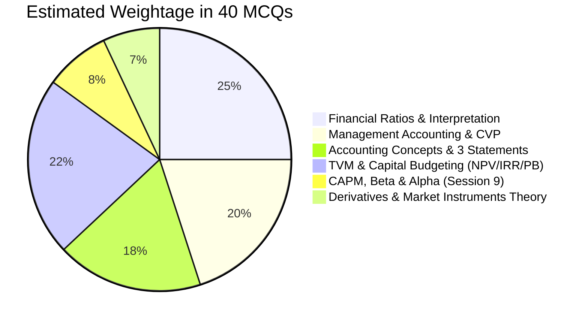

# 🎯 FMI Exam Master Plan: 100/100 from Scratch

## 📋 Exam Blueprint & Instructor Constraints

| Parameter | Specification | Strategic Implication |
| :--- | :--- | :--- |
| **Duration** | 2 Hours (120 minutes) | Exactly **3 minutes per question** — generous timing. |
| **Questions** | ~40 MCQs | ~20–24 Theory / Conceptual + ~16–20 Simple Numericals. |
| **Math Difficulty** | Basic arithmetic only ($+$, $-$, $\times$, $\div$) | No iterative solver needed; use shortcut formulas & plug-in options. |
| **Calculator** | May **NOT** be allowed | All math is designed to work with clean round numbers or PV tables provided. |
| **Formula Sheet** | Ratios & TVM/PV factors provided | **Must memorize**: CVP formulas (Break-even, P/V, Margin of Safety, Contribution). |
| **High Priority** | **Sessions 1 to 9** (Massive weightage) | Accounting basics, Ratios, CVP, TVM, Capital Budgeting, CAPM/Beta. |
| **Low / No Calculation** | Derivatives, WACC, Bonds, DCF | **Strictly theoretical only**: No bond pricing/YTM math, no WACC computation, no Black-Scholes math. |

---

## 🗺️ High-Yield Topic Matrix & Mark Distribution



---

## 🗓️ The 4-Phase Study Roadmap (From Zero to 100)

### 🟢 Phase 1: Conceptual Core & Must-Memorize Formulas (Days 1–2)
*Goal: Secure 100% of theoretical marks from Sessions 1–7 and commit unprovided formulas to memory.*

#### 1. Accounting Foundations & Conventions
- **The Golden Balance**: $\text{Assets} = \text{Liabilities} + \text{Equity}$.
  - Income & Gains increase Equity; Expenses & Losses decrease Equity.
  - Drawings & Dividends decrease Equity directly (they are NOT operating expenses).
- **Accounting Principles (Guaranteed MCQs)**:
  - *Business Entity*: Personal transactions separate from company.
  - *Going Concern*: Value assets at depreciated cost, not liquidation/scrap.
  - *Accrual vs Cash*: Revenue/expense recorded when earned/incurred, not when cash changes hands.
  - *Matching*: Match costs to the exact revenues they generated (e.g., COGS vs Unsold Inventory).
  - *Prudence/Conservatism*: Never anticipate profits; provide for all probable losses.
  - *Materiality*: Insignificant amounts don't require pedantic disclosure.

#### 2. Three Statements & Linkage
- **Income Statement**: $\text{Sales} - \text{COGS} = \text{Gross Profit} \xrightarrow{-\text{Opex}} \text{EBIT} \xrightarrow{-\text{Interest}} \text{EBT} \xrightarrow{-\text{Tax}} \text{PAT}$.
- **Reconciliation of PAT to Operating Cash Flow**:
  - Add back Depreciation & Amortization (non-cash).
  - **Subtract** increase in Current Assets (Receivables $\uparrow$, Inventory $\uparrow$ consume cash).
  - **Add** increase in Current Liabilities (Payables $\uparrow$ preserves cash).

#### 3. Management Accounting & CVP (MUST MEMORIZE FORMULAS)
*These formulas will NOT be on your formula sheet!*

$$\text{Contribution} = \text{Selling Price (SP)} - \text{Variable Cost (VC)}$$

$$\text{P/V Ratio (Profit-Volume)} = \frac{\text{Contribution}}{\text{Sales}} = \frac{\text{SP} - \text{VC}}{\text{SP}}$$

$$\text{Break-Even Point (Units)} = \frac{\text{Fixed Cost}}{\text{Unit Contribution}}$$

$$\text{Break-Even Point (Value/₹)} = \frac{\text{Fixed Cost}}{\text{P/V Ratio}}$$

$$\text{Target Profit (Units)} = \frac{\text{Fixed Cost} + \text{Target Profit}}{\text{Unit Contribution}}$$

$$\text{Margin of Safety (MoS)} = \text{Actual Sales} - \text{Break-Even Sales} = \frac{\text{Profit}}{\text{P/V Ratio}}$$

$$\text{MoS \%} = \frac{\text{MoS Sales}}{\text{Actual Sales}} \times 100$$

> [!IMPORTANT]
> **Key Intuition to remember for MCQs**:
> - A price cut **hurts break-even the most** (dramatically lowers unit contribution).
> - Marginal costing expenses fixed overheads entirely in the period; Absorption costing puts part of fixed overheads into unsold inventory.

---

### 🟡 Phase 2: Ratio Analysis & Interpretation Mastery (Days 3–4)
*Goal: Solve any ratio numerical in under 60 seconds and answer qualitative interpretation questions.*

Even though formulas are provided, you must know **what movement means**:

| Ratio Category | Key Ratios | Interpretation Traps |
| :--- | :--- | :--- |
| **Liquidity** | $\text{Current Ratio} = \frac{\text{CA}}{\text{CL}}$ (Ideal: 1.5–2.0)<br>$\text{Quick Ratio} = \frac{\text{CA} - \text{Inventory}}{\text{CL}}$<br>$\text{Cash Ratio} = \frac{\text{Cash}}{\text{CL}}$ | Low cash ratio isn't necessarily bad if debtor collection is rapid and receivables quality is high. |
| **Efficiency / Working Capital** | $\text{Inventory Days} = \frac{\text{Inventory} \times 365}{\text{COGS}}$<br>$\text{Receivable Days} = \frac{\text{Debtors} \times 365}{\text{Sales}}$<br>$\text{Payable Days} = \frac{\text{Creditors} \times 365}{\text{COGS}}$ | **$\text{Operating Cycle} = \text{Inventory Days} + \text{Receivable Days} - \text{Payable Days}$**. Shorter is better (less working capital tied up). |
| **Solvency / Leverage** | $\text{Debt-to-Equity} = \frac{\text{Debt}}{\text{Equity}}$<br>$\text{Interest Coverage} = \frac{\text{EBIT}}{\text{Interest}}$ | Interest coverage below $2\times$ is an alarming warning sign of default risk. |
| **Profitability & Dupont** | $\text{Gross Margin} = \frac{\text{GP}}{\text{Sales}}$<br>$\text{Net Margin} = \frac{\text{PAT}}{\text{Sales}}$<br>$\text{ROCE} = \frac{\text{EBIT}}{\text{Capital Employed}}$ | **DuPont Identity**: $\text{ROE} = \text{Net Margin} \times \text{Asset Turnover} \times \text{Equity Multiplier}$. Shows whether return is driven by high markup, high volume, or leverage. |
| **Market / Valuation** | $\text{P/E} = \frac{\text{Market Price}}{\text{EPS}}$<br>$\text{Dividend Yield} = \frac{\text{DPS}}{\text{Price}}$<br>$\text{Payout} = \frac{\text{DPS}}{\text{EPS}}$<br>$\text{EV} = \text{Market Cap} + \text{Debt} - \text{Cash}$ | High P/E implies high growth expectations. EV measures total enterprise takeover cost. |

---

### 🟠 Phase 3: TVM & Capital Budgeting Precision (Days 5–6)
*Goal: Master arithmetic calculation with clean numbers and resolve capital budgeting conflicts.*

#### 1. Time Value of Money (TVM)
- **Rule of 72**: $\text{Years to double} \approx \frac{72}{\text{Interest Rate \%}}$.
- **Compounding vs Discounting**:
  - $FV = PV(1+r)^n$ (forward)
  - $PV = \frac{FV}{(1+r)^n} = FV \times \text{PV Factor}$ (backward)
- **Annuities**:
  - Ordinary Annuity = payment at end of period.
  - Annuity Due = payment at start (value is $(1+r)$ times higher).
- **Perpetuity**:
  - Level: $PV = \frac{C}{r}$
  - Growing: $PV = \frac{C_1}{r - g}$ (where $r > g$)

#### 2. Capital Budgeting Decision Rules (Guaranteed Questions)
- **Net Present Value (NPV)**:
  $$\text{NPV} = \sum \frac{CF_t}{(1+r)^t} - \text{Initial Investment}$$
  - Rule: Accept if $\text{NPV} > 0$.
  - Best metric because it measures absolute rupee value created.
- **Internal Rate of Return (IRR)**:
  - Discount rate where $\text{NPV} = 0$.
  - Rule: Accept if $\text{IRR} > \text{Cost of Capital } (r)$.
- **NPV vs. IRR Conflict (Mutually Exclusive Projects)**:
  - **Always follow NPV!**
  - Why? IRR ignores scale (e.g., $100\%$ return on ₹10 vs $20\%$ return on ₹1,00,000) and unrealistically assumes cash flows are reinvested at the IRR rate.
- **Payback Period**:
  $$\text{Payback} = \text{Years before full recovery} + \frac{\text{Unrecovered cost at start of year}}{\text{Cash flow during year}}$$
  - Flaw: Ignores time value of money and all cash flows after the payback cutoff.
- **Profitability Index (PI)**:
  $$\text{PI} = \frac{\text{PV of Inflows}}{\text{Initial Investment}}$$
  - Rule: Accept if $\text{PI} > 1.0$. Use to rank projects under **Capital Rationing** (budget limits).

---

### 🔵 Phase 4: Sessions 9–16 Non-Calculative & Theory Rules (Day 7)
*Goal: Grab all free marks from CAPM, Derivatives, and Instruments.*

- **Session 9 (CAPM & Beta)**:
  - Cost of Equity: $r_e = R_f + \beta(R_m - R_f)$
  - $\beta = 1.0$: market risk; $\beta > 1$: aggressive/cyclical; $\beta < 1$: defensive.
  - Alpha ($\alpha$): Actual return minus CAPM required return. Positive alpha = outperformance.
- **Sessions 13–14 (Derivatives Theory)**:
  - *Forward*: Private OTC, customizable, high counterparty risk, settled at maturity.
  - *Futures*: Exchange-traded, standardized, daily mark-to-market margin, clearinghouse eliminates default risk.
  - *Call Option*: Right to **buy**. Buyer profits when price rises; maximum loss is limited to the premium paid.
  - *Put Option*: Right to **sell**. Buyer profits when price drops.
  - *Seller (Writer)*: Earns premium upfront, exposed to potentially unlimited loss.
  - *Option Moneyness*: In-the-money (ITM), At-the-money (ATM), Out-of-the-money (OTM).

---

## ⚡ Daily Study Schedule (Next 7 Days)

```
┌────────────────────────────────────────────────────────┐
│ Block A (1.5 hrs) : Concept Reading & Flash Notes      │
│ Block B (1.5 hrs) : Handwritten Math & Formula Drills  │
│ Block C (1.0 hr)  : Rapid MCQ Solving & Error Log      │
└────────────────────────────────────────────────────────┘
```

1. **Day 1**: Accounting Foundations, Assumptions, Conventions & The 3 Statements.
2. **Day 2**: Management Accounting, Cost Classifications, and CVP Formulas.
3. **Day 3**: Liquidity, Efficiency, and Solvency Ratios (Worked Examples).
4. **Day 4**: Profitability Ratios, Dupont Analysis, and Market/Valuation Ratios.
5. **Day 5**: TVM Calculations (FV, PV, Annuity, Perpetuity, Rule of 72).
6. **Day 6**: Capital Budgeting (NPV, IRR, Payback, PI, Mutually Exclusive Conflicts).
7. **Day 7**: CAPM & Derivatives Theory + Full 40-Question Mock Exam.

---

## 🎯 100/100 Exam Hall Execution Strategy

1. **Pass 1 — The 30-Second Sweeper (Questions 1 to 40, ~40 mins)**:
   - Answer all pure theory questions immediately (Accounting principles, Derivatives features, NPV vs IRR rules).
   - If a numerical requires $>2$ steps of arithmetic, star it and move forward.
2. **Pass 2 — Arithmetic Drills (~50 mins)**:
   - Solve the numerical questions: CVP break-even, ratios, and PV.
   - **Elimination technique**: Estimate before calculating. If sales are 10L and break-even is 6L, MoS is 40%—often only one option will be near 40%.
3. **Pass 3 — Verification & Trap Detection (~30 mins)**:
   - Check units: Are figures in Lakhs, Crores, or raw numbers?
   - Check conventions: Did the question ask for *Annual* or *Monthly* figures? *Margin of Safety in units or value*?
   - Verify that all 40 questions have an option marked (no negative marking unless stated).
